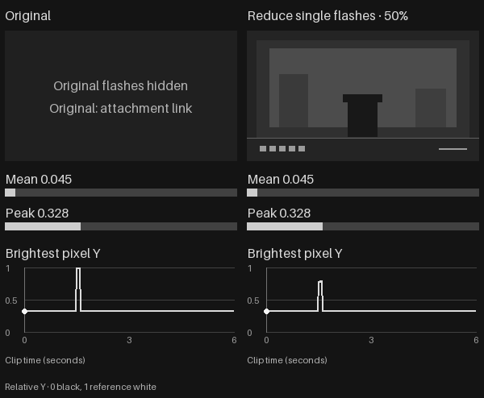
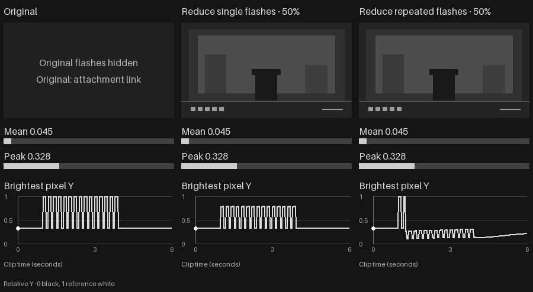

# Sunglasses

[](README.md)
[](README.zh-CN.md)

Games too flashy? Put a pair of sunglasses on your screen.

See the results at **50% strength**, with brightness bars and curves.

To avoid discomfort, the original flashing picture is fully covered in each demo. To view the originals, use the attachment links below (contains flashing).

**Reduce single flashes**

Dims harsh sudden flashes while keeping dark foreground details visible.



[Original attachment: single bright burst (contains one flash)](assets/demos/original-single-burst.gif)

<details>
<summary>Repeated-flash results: flashing remains after filtering — expand to view</summary>

**Reduce single flashes and Reduce repeated flashes**

Left: original picture covered. Middle: Reduce single flashes. Right: Reduce repeated flashes. The brightness bars and curves retain the actual measurements for all three.



</details>

[Original attachment: repeated flashes (contains 5 high-contrast flashes per second)](assets/demos/original-repeated-flashes.gif)

## Modes

| Mode | Effect |
| --- | --- |
| Reduce single flashes | Briefly dims bright areas when the screen suddenly lights up, then recovers. Steady bright scenes won't keep triggering it. |
| Dim screen | Directly lowers the overall brightness of the display without screen capture. |
| Reduce repeated flashes | Automatically lowers brightness and contrast during repeated flashes, affecting the whole picture. |

Works on a chosen display and supports English and Simplified Chinese. All frames are processed locally in real time—nothing is saved, uploaded, or injected into game processes.

## How to Use

If you have a portable package, extract it and run `Sunglasses.exe`.

- **Mouse**: Click the left lens to toggle the filter, drag the right lens to adjust strength, and open the glasses case to switch display, mode, or language.
- **Shortcuts**: `Ctrl+Alt+S` to toggle, `Ctrl+Alt+Esc` to disable immediately.
- Starts **off** by default (primary display, Reduce single flashes mode, 50% strength). Exiting the app removes the filter.

## Build from Source

Requirements: Windows 11 x64, Visual Studio (with C++ desktop development and Windows SDK), CMake 3.24+, Ninja, and Python 3.12.

```powershell
.\build.cmd
.\run.cmd
```

Run offline tests and lint checks (requires uv, Node.js, and FFmpeg):

```powershell
.\ci.cmd check
```

## Limitations

- **How it works**: Uses screen capture plus an overlay window, so it cannot block the very first bright frame. Designed for large brightness spikes rather than small particle effects, camera shake, or monitor hardware flicker.
- **Compatibility**: Targets Windows 11 SDR displays. HDR, exclusive fullscreen, and anti-cheat compatibility are not yet verified.
- **Scope**: Built for visual comfort only, not medical protection.

## Credits & License

- **Reduce repeated flashes** is ported from Apple's open-source [VideoFlashingReduction](https://github.com/apple-aiml-research/VideoFlashingReduction/tree/6e9604d92446c8e6763bc53c5e12ccc4e0046796) reference algorithm; see the [source mapping and MIT notice](sunglasses/data/APPLE_VIDEO_FLASHING_REDUCTION_NOTICE.md).
- Offline evaluation references [ColorVideoVDP](https://github.com/gfxdisp/ColorVideoVDP/tree/v0.5.7) ([SIGGRAPH 2024](https://doi.org/10.1145/3658144)) and [WCAG 2.2 flash definitions](https://www.w3.org/WAI/WCAG22/Understanding/three-flashes-or-below-threshold.html).
- Licensed under [GPL-3.0-only](LICENSE).
